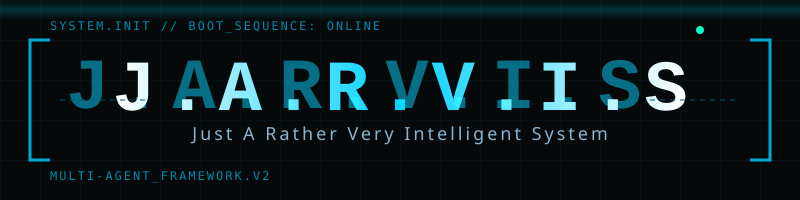
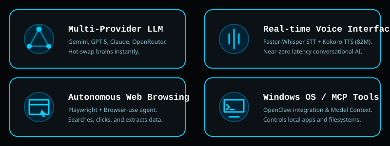
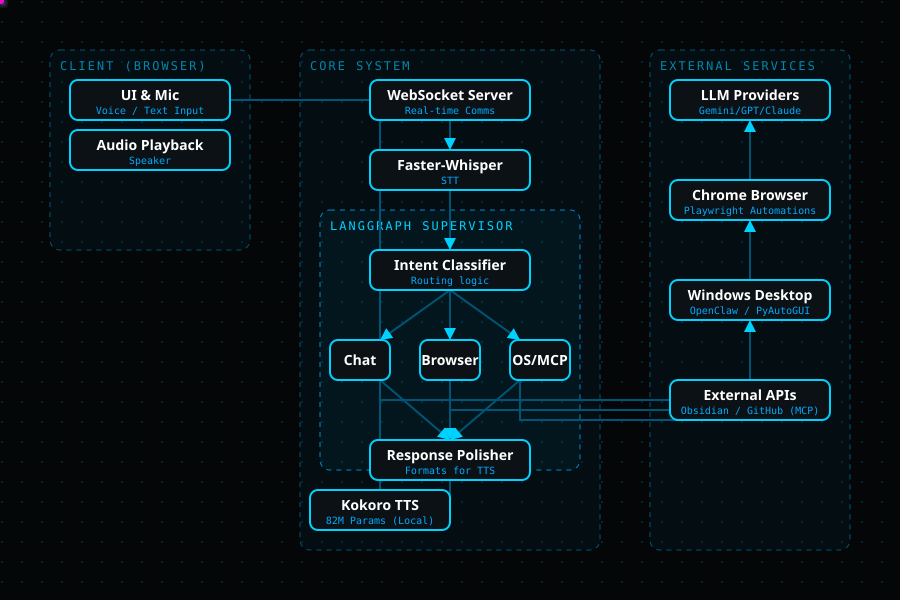

<div align="center">

<picture>
  
</picture>

<br>

<picture>
  
</picture>

# J.A.R.V.I.S v3.0 (Release V3)

**Just A Rather Very Intelligent System — Full-Stack Agentic Studio, `<3ms` Jev System-1 Reflex Harness, OpenJarvis 5-Primitive Engine & Minimal Hardware-Grade Companion UI**

[-0EA5E9.svg)](https://github.com/ManasSoni-2009/Project-JARVIS/releases)
[](https://nodejs.org/)
[](https://react.dev/)
[](LICENSE)

</div>

---

## Overview — What's New in Release V3 (`v3.0.0`)

**J.A.R.V.I.S v3.0** is a ground-up architectural and visual evolution into a full-stack **TypeScript / Node.js / React 19** agentic workspace combining three foundational systems:

1. **OpenJarvis 5-Primitive Core ([`open-jarvis/openjarvis`](https://github.com/open-jarvis/openjarvis))**:
   - **Intelligence**: Multi-model cascade (`gemini-4-hydrogen` → `gemini-3.1-flash-lite` → `OpenJarvis Local Cognitive Synthesis`) with a 5-minute quota circuit-breaker, plus `gemini-3.5-transcribe` STT and `gemini-3.8-flash-lite-tts` Neural TTS (`Kore`, `Fenrir`, `Puck`, `Charon`, `Zephyr`).
   - **InferenceEngine**: Prompt-normalized LRU response cache (`1ms` cache hits) + real-time full-duplex WebSocket event streaming (`/ws`).
   - **Agentic Logic**: 7-way specialist orchestration (`agent_desktop`, `codex_diff`, `nus_organizer`, `obsidian`, `mcp_tool`, `browser`, `chat`).
   - **Tools & Memory**: Persistent multi-session memory (`./data/sessions.json`) with strictly monotonic turn keys + Obsidian Second Brain markdown vault (`./data/vault`).
   - **Learning & Telemetry**: Real-time `OpenJarvisTrace` execution traces measuring System-1 vs. System-2 latency and energy efficiency scores.
2. **Jev System-1 Fast Reflex Harness ([`potlakai/nus-desktop`](https://github.com/potlakai/nus-desktop) inspired)**:
   - Deterministic **`1ms–3ms`** intent triage and multi-`@ref` extraction with zero pre-flight LLM network overhead.
   - Built-in **NŪS Companion Milestone & Deadline Organizer** for natural-language task capture and syllabus extraction.
3. **Semantic Desktop Automation ([`vercel-labs/agent-desktop`](https://github.com/vercel-labs/agent-desktop))**:
   - Maps desktop windows and controls into **17 deterministic `@ref` accessibility nodes (`@e1`–`@e17`)** across 3 interactive workspace windows with `snapshot`, `click`, `type`, `press`, and `focus` commands, plus a **Local CLI Bridge** (`ws://127.0.0.1:44820`).

<div align="center">
  <picture>
    
  </picture>
</div>

---

## Visual System — Apple × OpenAI Codex PC × Hedwig Studio

- **Hedwig Memory Sidebar**: Collapsible left-hand thread manager with spring-animated active pills (`layoutId`), live search filter, turn counts, and persistent session switching.
- **Concentric Spatial Studio Stage**: Unified top segmented Inspector switcher (`Diffs`, `@ref`, `Vault`, `Traces`, `Term`), custom spring-animated `StudioDropdown` menus (zero native `<select>` elements), and review-before-apply unified diff outbox.
- **Pure-Avatar Minimal Visor Pet Pill (`JevPetPill.tsx`)**: Hardware-grade bottom-right capsule containing **100% the character's geometric visor face** (zero text inside the capsule, zero split sections) with 60fps GSAP cursor tracking (`gsap.quickTo`), poppy enlarge-and-snap-back physics (`back.out` + `elastic.out`), rubber-band drag resistance, and a 5-bar acoustic harmonic equalizer during voice playback.
- **Seamless Daylight & Graphite Themes**: Instant toggle between Apple Daylight (`#F5F5F7`) and Pro Graphite (`#09090B`) dark mode.

---

## System Architecture

<div align="center">
  <picture>
    
  </picture>
</div>

```
User Input (Text / WebSocket Binary Audio / @ref Action)
   │
   ▼
[Jev System-1 Fast Reflex Harness (<3ms)]
   ├──► @e1..@e17 UI Action ────► [vercel-labs/agent-desktop Engine] (Web Sandbox / Local CLI Bridge)
   ├──► Code Refactor / Patch ──► [Codex Diff Outbox Engine] (Unified diff + Approve / Revert)
   ├──► Milestones / Deadlines ─► [NŪS Companion Organizer] (Task capture & status sync)
   ├──► Second Brain Notes ─────► [Obsidian Memory Vault] (Markdown wikilinks, tags & Deep RAG)
   ├──► GitHub / Files / ArXiv ─► [MCP Tool Client] (Workspace FS, GitHub REST API, ArXiv)
   ├──► Live Web Grounding ─────► [Browser Grounding Agent] (Google Search + URL Context)
   └──► Reasoning / Chat ───────► [OpenJarvis System-2 Cognitive Engine] (LRU Cache + Model Cascade)
                                         │
                                         ▼
                        [Neural TTS (gemini-3.8-flash-lite-tts) + Web Speech Hybrid]
```

---

## V3 Technology Stack

| Layer | Technology | Purpose |
|:---|:---|:---|
| **Runtime & Server** | **Node.js 22+**, **Express 4**, **tsx**, **ws** | Full-stack HTTP + WebSocket (`/ws`) server on port `3000` |
| **Frontend Framework** | **React 19**, **TypeScript 7**, **Vite 8** | Modular spatial studio interface with strict typing |
| **Styling & Motion** | **Tailwind CSS v4**, **Motion (`motion/react`)**, **GSAP 3.15** | Concentric curvature, spring transitions, and 60fps visor physics |
| **AI SDK & Models** | **`@google/genai` (`^3.3.0`)** | `gemini-4-hydrogen`, `gemini-3.1-flash-lite`, `gemini-3.5-transcribe`, `gemini-3.8-flash-lite-tts` |
| **Multi-Provider Support** | **Google Gemini**, **OpenAI**, **Anthropic**, **OpenRouter** | Hot-swappable provider routing with automatic quota circuit-breaker |
| **Desktop & Memory** | **`agent-desktop` `@ref`**, **Obsidian Markdown**, **JSON Session Store** | Persistent threads (`./data/sessions.json`), vault (`./data/vault`), and code sandbox (`./data/codex-workspace`) |

---

## Installation & Quick Start Guide (1-Click / 1-Command Launch)

Running J.A.R.V.I.S v3.0 from source takes **one click** or **one command** — the launcher automatically creates `.env`, installs dependencies if missing, boots the full-stack server on port `3000`, and opens the Studio GUI in your browser.

### Option A — 1-Click / 1-Command Launch (Recommended)

```bash
# Clone the repository (Release V3)
git clone https://github.com/ManasSoni-2009/Project-JARVIS.git
cd Project-JARVIS
```

- **Windows**: Double-click **`jarvis.bat`** (or run `.\jarvis.bat` in PowerShell / Command Prompt)
- **macOS / Linux**: Run **`./jarvis.sh`**
- **Any OS (Node.js 22+)**: Run **`npm run jarvis`**

Once **[http://localhost:3000](http://localhost:3000)** opens:
1. Click the **`Engine`** button in the bottom-left of the Hedwig sidebar to open the **Studio Engine & Workspace Setup** modal.
2. Select your **Intelligence Provider**, **Primary Model Preset** (`gemini-4-hydrogen` / `gemini-3.1-flash-lite`), **Reasoning Depth**, **Neural Voice Persona** (`Kore`, `Fenrir`, `Puck`, `Charon`, `Zephyr`), **Desktop Automation Backend**, and **Obsidian Vault Directory** — all saved automatically to `./data/settings.json`.
3. Click **"Run Readiness Check"** inside the modal to run a live 5-subsystem diagnostic self-test directly in the GUI.

---

### Option B — Manual Developer Setup & Environment Variables

If you prefer manual control over environment variables, edit `.env` (automatically generated from `.env.example` on first launch):

```env
# Primary Intelligence & Voice Key (Server-side environment variable)
GEMINI_API_KEY="your_gemini_api_key_here"

# Default Provider: google | openai | anthropic | openrouter
LLM_PROVIDER="google"

# Neural TTS Persona: Kore | Fenrir | Puck | Charon | Zephyr
TTS_VOICE="Kore"
TTS_LANG="en-gb"

# Optional Multi-Provider Keys
OPENAI_API_KEY=""
ANTHROPIC_API_KEY=""
OPENROUTER_API_KEY=""

# Optional GitHub Token (for MCP GitHub tools & automated Release V3 publishing)
GITHUB_TOKEN=""

# Local Obsidian Second Brain Vault Path
OBSIDIAN_VAULT_PATH="./data/vault"
```

```bash
# Start development server
npm run dev

# Run the 14-point automated verification & latency benchmark suite
npm run verify

# Build & start production server
npm run lint && npm run build
NODE_ENV=production npm start
```

---

## Interactive Prompts & Commands

| Prompt / Command | Subsystem Triggered | What Happens |
|:---|:---|:---|
| `"Click @e4 to execute the CI command"` | **Jev Sys-1 → `agent-desktop`** (`1ms` reflex) | Locks onto `@e4`, runs the sandbox CI suite, and updates status node `@e7` |
| `'Type "npm run verify" into @e3'` | **Jev Sys-1 → `agent-desktop`** (`1ms` reflex) | Focuses textfield `@e3` and types the command string into the runner |
| `"Click @e12"` | **Jev Sys-1 → `agent-desktop` + Vault** | Commits the NŪS Scratchpad note (`@e10`/`@e11`) directly into the Obsidian Vault |
| `"Refactor jevReflexRouter.ts to add speculative telemetry"` | **Jev Sys-1 → `codex_diff`** | Synthesizes a unified diff in the Diff Outbox ready for 1-click **Approve** or **Revert** |
| `"Add task: Complete v3.0 audit by 2026-11-20 high priority"` | **Jev Sys-1 → `nus_organizer`** | Schedules a P0 milestone in the NŪS Companion panel |
| `"Analyze my Obsidian vault notes about architecture"` | **Jev Sys-1 → `obsidian` RAG** | Searches `./data/vault/*.md` wikilinks and synthesizes insights |
| `"List files in the workspace repository"` | **Jev Sys-1 → `mcp_tool`** | Dispatches an MCP filesystem/GitHub tool call |

---

## Project Structure (v3.0)

```
Project-JARVIS/
├── server.ts                          # Express + WebSocket (/ws) + Vite full-stack entry point (Port 3000)
├── server/
│   ├── config.ts                      # Multi-provider LLM client, 5-min quota circuit-breaker & 1ms LRU cache
│   ├── agentDesktop/
│   │   └── engine.ts                  # vercel-labs/agent-desktop @e1..@e17 tree & Local CLI Bridge
│   ├── agents/
│   │   ├── chatAgent.ts               # Dynamic System-1 / System-2 conversational synthesis
│   │   ├── browserAgent.ts            # Google Search & URL context grounding agent
│   │   └── osAgent.ts                 # Desktop vision & OS automation adapter
│   ├── brain/
│   │   ├── jevReflex.ts               # <3ms deterministic Jev System-1 Fast Reflex router
│   │   ├── supervisor.ts              # OpenJarvis 5-Primitive orchestrator & trace recorder
│   │   ├── prompts.ts                 # J.A.R.V.I.S persona & structured system prompts
│   │   └── state.ts                   # Shared TypeScript interfaces for traces, diffs, and @refs
│   ├── codex/
│   │   └── workspace.ts               # Unified diff generator, patch outbox, apply & revert engine
│   ├── mcp/
│   │   └── client.ts                  # Safe workspace filesystem, GitHub API, and ArXiv tools
│   ├── memory/
│   │   ├── session.ts                 # Persistent multi-thread store (./data/sessions.json)
│   │   └── obsidian.ts                # Obsidian markdown vault, wikilink auto-linker & RAG engine
│   ├── nus/
│   │   └── organizer.ts               # NŪS Companion milestone & syllabus deadline organizer
│   └── transport/
│       ├── pipeline.ts                # Full-duplex event pipeline (STT → Jev → Supervisor → TTS)
│       ├── tts.ts                     # gemini-3.8-flash-lite-tts + 24kHz WAV harmonic cue generator
│       └── stt.ts                     # gemini-3.5-transcribe + model failover cascade
├── src/
│   ├── App.tsx                        # Hedwig Memory Sidebar + Primary Studio Stage + Voice integration
│   ├── index.css                      # Tailwind CSS v4 design tokens, scrollbars & micro-interactions
│   ├── components/
│   │   ├── JevPetPill.tsx             # 100% pure-avatar minimal visor pill with 60fps GSAP physics
│   │   ├── CodexWorkbench.tsx         # Modular right-hand Inspector (Diffs, @ref, Vault, Traces)
│   │   └── StudioDropdown.tsx         # Custom spring-animated popover dropdown component
│   └── types/
│       └── jarvis.ts                  # Shared client-side TypeScript definitions
├── scripts/
│   └── verify-prod-v3.ts              # 14-point automated verification & latency benchmark runner
├── RELEASE_V3.md                      # Release V3 architectural specification
└── package.json                       # v3.0.0 dependencies & scripts
```

---

## License

This project is licensed under the MIT License — see the [LICENSE](LICENSE) file for details.
